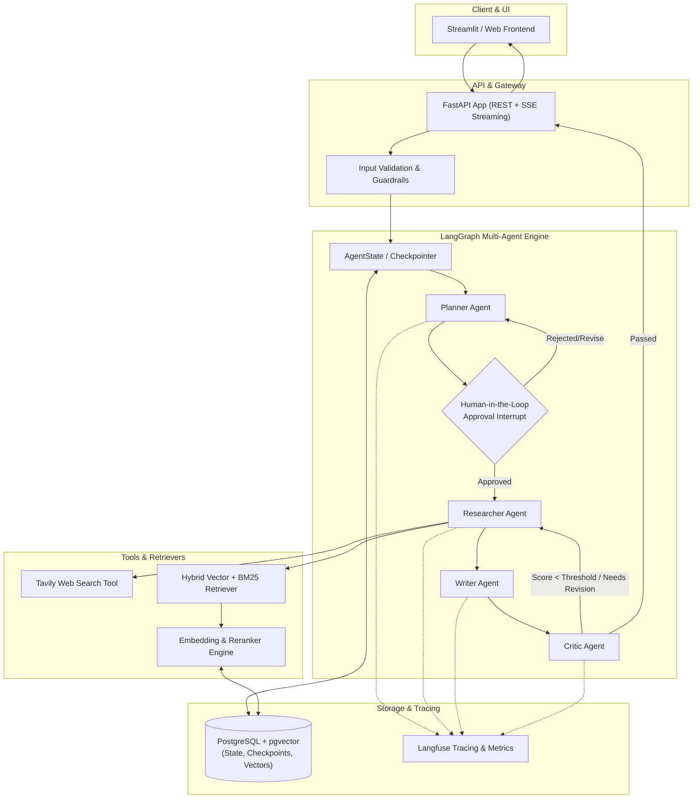

# AI Research Copilot: Master Execution Blueprint & Engineering Roadmap

This document outlines the end-to-end master plan for building, verifying, hardening, and deploying the **AI Research Copilot** portfolio platform.

---

## 1. System Architecture Overview



---

## 2. Git Lifecycle & Commit Discipline

To maintain a clean, portfolio-ready Git history, every phase will follow a disciplined workflow:
1. **Initialize Git Repository**: Setup at Phase 0 with a comprehensive `.gitignore`.
2. **Phase Branches / Structured Commits**: We will commit progress methodically per phase using the Conventional Commits standard:
   - `chore: initial repository setup, config, and skeleton` (Phase 0)
   - `feat(llm): add model abstraction and researcher web search agent` (Phase 1)
   - `feat(rag): add pgvector document ingestion and hybrid retriever` (Phase 2)
   - `feat(graph): assemble multi-agent langgraph workflow with revision loop` (Phase 3)
   - `feat(persistence): implement postgres checkpointer and hitl approval interrupt` (Phase 4)
   - `feat(api): add fastAPI SSE streaming endpoints and interactive streamlit UI` (Phase 5)
   - `feat(evals): integrate langfuse tracing and automated RAGAS eval suite` (Phase 6)
   - `feat(guardrails): add prompt injection filters, token budgets, and retries` (Phase 7)
   - `ci/cd: add multi-stage dockerfiles, github actions ci, and deployment setup` (Phase 8)
3. **Verification Before Commit**: Each phase will be tested and verified before committing.

---

## 3. Master Repository & Directory Structure

```text
research-copilot/
├── .github/
│   └── workflows/
│       ├── ci.yml                     # Linting, type checks, unit & integration tests
│       └── deploy.yml                 # Build Docker image & trigger deployment
├── docker/
│   ├── Dockerfile.backend             # Production container for FastAPI + LangGraph
│   ├── Dockerfile.frontend            # Production container for Streamlit UI
│   └── docker-compose.yml             # Local dev cluster (Postgres+pgvector, App, UI)
├── docs/
│   ├── architecture.md                # System design & graph state flow specs
│   └── evals_report.md                # RAGAS benchmark scores & evaluation runs
├── evals/
│   ├── datasets/
│   │   ├── golden_qa.json             # Ground truth questions, context, and answers
│   │   └── research_prompts.json      # Standard test cases for multi-agent loops
│   ├── run_evals.py                   # Automated evaluation runner with RAGAS/DeepEval
│   └── metrics.py                     # Custom scoring (faithfulness, hallucination rate)
├── frontend/
│   ├── app.py                         # Streamlit application entry point
│   ├── components/
│   │   ├── plan_viewer.py             # Plan approval and revision controls (HITL)
│   │   ├── progress_stream.py         # Real-time SSE token & node event listener
│   │   └── report_renderer.py         # Markdown output with interactive citations
│   └── requirements.txt               # Frontend-specific dependencies
├── src/copilot/
│   ├── __init__.py
│   ├── main.py                        # FastAPI startup, middleware, and lifespan
│   ├── config.py                      # Pydantic Settings (env vars, model keys, timeouts)
│   ├── api/
│   │   ├── __init__.py
│   │   ├── routes.py                  # Endpoints: /research, /resume, /upload, /health
│   │   ├── schemas.py                 # Pydantic request/response & SSE event models
│   │   └── dependencies.py            # DB session and service dependency injection
│   ├── agents/
│   │   ├── __init__.py
│   │   ├── base.py                    # Base agent abstraction & system prompt helpers
│   │   ├── planner.py                 # Generates structured research plan & sub-questions
│   │   ├── researcher.py              # Queries tools (web + RAG) and aggregates evidence
│   │   ├── writer.py                  # Synthesizes evidence into cited report
│   │   └── critic.py                  # Evaluates clarity, coverage, accuracy & citations
│   ├── graph/
│   │   ├── __init__.py
│   │   ├── state.py                   # AgentState TypedDict / Pydantic models
│   │   ├── workflow.py                # LangGraph StateGraph builder, edges & interrupts
│   │   └── checkpointer.py            # PostgresSaver checkpoint configuration
│   ├── tools/
│   │   ├── __init__.py
│   │   ├── web_search.py              # Tavily API client with error handling & caching
│   │   └── rag_search.py              # Local knowledge base search tool
│   ├── rag/
│   │   ├── __init__.py
│   │   ├── ingest.py                  # PDF parser, recursive chunker & metadata tagging
│   │   ├── embeddings.py              # Embedding model provider wrapper
│   │   └── retriever.py               # Vector similarity search with reranking
│   ├── llm/
│   │   ├── __init__.py
│   │   ├── factory.py                 # Model router (Anthropic Claude, OpenAI, fallback)
│   │   └── wrappers.py                # Structured output wrappers & token tracker
│   ├── db/
│   │   ├── __init__.py
│   │   ├── session.py                 # Async SQLAlchemy engine & session factory
│   │   ├── models.py                  # Research runs, document metadata, audit logs
│   │   └── migrations/                # Alembic migration scripts
│   ├── guardrails/
│   │   ├── __init__.py
│   │   ├── input_filters.py           # Prompt injection detection & safety checks
│   │   └── cost_limiter.py            # Token budget enforcer per research execution
│   └── observability/
│       ├── __init__.py
│       └── langfuse.py                # Callback handlers, span decorators & trace hooks
├── tests/
│   ├── unit/                          # Unit tests for agents, chunkers, and tools
│   ├── integration/                   # Graph execution and API endpoint tests
│   └── conftest.py                    # Pytest fixtures and mock LLM configurations
├── .env.example
├── pyproject.toml
└── README.md
```

---

## 3. Phase-by-Phase Detailed Execution Plan

```mermaid
gantt
    title AI Research Copilot Roadmap
    dateFormat  X
    axisFormat  Day %d
    section Foundation
    Phase 0 - Setup & Skeleton          :active, 0, 3
    Phase 1 - LLM Wrapper & Web Agent   :3, 7
    Phase 2 - RAG Pipeline (pgvector)   :7, 12
    section Multi-Agent Core
    Phase 3 - LangGraph Orchestration   :12, 18
    Phase 4 - Persistence & HITL        :18, 23
    section API & Interface
    Phase 5 - FastAPI Streaming & UI    :23, 28
    section Production Readiness
    Phase 6 - Observability & Evals     :28, 33
    Phase 7 - Guardrails & Hardening    :33, 37
    Phase 8 - Docker & Cloud Deploy     :37, 42
```



---

### Phase 0: Setup, Environment & Skeleton
* **Primary Objective**: Establish a rock-solid Python modern project environment, typed configuration, async database connection, and basic healthcheck API.
* **Key Tasks**:
  1. Configure `pyproject.toml` with strict dependencies (`langgraph`, `fastapi`, `pydantic-settings`, `asyncpg`, `sqlmodel`/`sqlalchemy`, `langfuse`, `uvicorn`).
  2. Implement environment validation in `config.py` using `pydantic-settings`.
  3. Set up local Docker Compose running PostgreSQL with `pgvector` enabled.
  4. Build healthcheck endpoint (`GET /health`) with live DB ping.
* **File Breakdown**:
  * `pyproject.toml`: Project metadata, dependencies, linters (`ruff`, `mypy`, `pytest`).
  * `.env.example`: Template for API keys (`ANTHROPIC_API_KEY`, `TAVILY_API_KEY`, `DATABASE_URL`, `LANGFUSE_*`).
  * `docker-compose.yml`: Services for `postgres` with `pgvector/pgvector:pg16`.
  * `src/copilot/config.py`: Strict environment schema with validation.
  * `src/copilot/main.py`: FastAPI app initialization and lifespan database hooks.
  * `src/copilot/api/routes.py`: Baseline `/health` endpoint returning system status.
  * `tests/unit/test_config.py`: Verifies configuration constraints and fail-safes.

---

### Phase 1: LLM Wrapper & Single Tool-Calling Web Agent
* **Primary Objective**: Create a unified LLM interface supporting structured output and a standalone web-search researcher tool.
* **Key Tasks**:
  1. Implement `llm/factory.py` to instantiate Claude or OpenAI models via a clean, swappable interface.
  2. Build `tools/web_search.py` wrapping the Tavily search API with structured query formatting and domain filtering.
  3. Create `agents/researcher.py` capable of taking a user research question, generating search queries, calling the search tool, and returning parsed findings.
* **File Breakdown**:
  * `src/copilot/llm/factory.py`: Factory function returning configured `ChatAnthropic` or `ChatOpenAI`.
  * `src/copilot/llm/wrappers.py`: Helpers for binding tools and enforcing Pydantic output schemas.
  * `src/copilot/tools/web_search.py`: Tavily search tool returning titles, snippets, URLs, and publication dates.
  * `src/copilot/agents/researcher.py`: Researcher agent prompt and tool-calling execution cycle.
  * `tests/unit/test_web_search.py`: Unit tests with mocked HTTP responses.
  * `tests/unit/test_researcher_agent.py`: Agent invocation and tool-call verification test.

---

### Phase 2: High-Precision RAG Pipeline (PDFs + pgvector)
* **Primary Objective**: Enable the copilot to index uploaded PDF documents and perform semantic retrieval alongside web searches.
* **Key Tasks**:
  1. Set up `pgvector` extension and document/chunk tables in PostgreSQL.
  2. Implement PDF ingestion: text extraction, recursive character chunking with overlap, and metadata tagging (file name, page number).
  3. Generate embeddings and store vectors with metadata in Postgres.
  4. Create `tools/rag_search.py` that exposes similarity retrieval with cosine distance and score thresholds.
* **File Breakdown**:
  * `src/copilot/db/models.py`: SQLAlchemy/SQLModel models for `Document` and `DocumentChunk` with `Vector(1536/3072)`.
  * `src/copilot/rag/ingest.py`: PDF reader (using `pypdf` or `pymupdf`) and chunking logic.
  * `src/copilot/rag/embeddings.py`: Embedding generator wrapper.
  * `src/copilot/rag/retriever.py`: Vector query logic with distance filtering.
  * `src/copilot/tools/rag_search.py`: Tool interface so agents can search internal documents.
  * `tests/unit/test_rag.py`: Ingestion, chunking, and similarity query integration test.

---

### Phase 3: LangGraph Multi-Agent Architecture
* **Primary Objective**: Build the core collaborative agent team (Planner, Researcher, Writer, Critic) inside a cyclical LangGraph state machine.
* **Key Tasks**:
  1. Define `AgentState` schema in `graph/state.py` containing topic, plan, search results, draft report, critique feedback, iteration count, and status.
  2. Build **Planner Agent**: breaks the topic into structured sub-topics and research steps.
  3. Build **Writer Agent**: synthesizes research findings into an academic-style report with inline citations `[1]`, `[2]`.
  4. Build **Critic Agent**: evaluates report completeness, factual support, and clarity. Emits structured assessment: `score` (1-10), `revision_needed` (bool), and `critique_notes`.
  5. Assemble `graph/workflow.py` with conditional routing: if `revision_needed` is true and iterations < max, loop back to researcher; otherwise route to end.
* **File Breakdown**:
  * `src/copilot/graph/state.py`: TypedDict defining shared graph state.
  * `src/copilot/agents/planner.py`: Planning logic producing ordered task lists.
  * `src/copilot/agents/writer.py`: Report synthesis and citation formatter.
  * `src/copilot/agents/critic.py`: Evaluation and revision generator.
  * `src/copilot/graph/workflow.py`: `StateGraph` definition with nodes, conditional edges, and termination criteria.
  * `tests/integration/test_graph_flow.py`: End-to-end execution of graph with mocked tool outputs.

---

### Phase 4: State Persistence & Human-in-the-Loop (HITL)
* **Primary Objective**: Add durability via PostgreSQL checkpointing so runs can pause for human approval and resume seamlessly.
* **Key Tasks**:
  1. Integrate `langgraph.checkpoint.postgres` (`PostgresSaver`) to persist graph state after each step.
  2. Introduce an interrupt after the Planner agent finishes so the user can inspect, approve, or edit the plan before deep research starts.
  3. Implement graph resume mechanics allowing state modification before proceeding.
* **File Breakdown**:
  * `src/copilot/graph/checkpointer.py`: Postgres checkpoint connection pool and table initializer.
  * `src/copilot/graph/workflow.py`: Updated with `interrupt_before=["researcher"]`.
  * `src/copilot/db/models.py`: Additional run tracking and thread ID associations.
  * `tests/integration/test_hitl.py`: Tests verifying graph interrupt, state inspection, and successful resumption.

---

### Phase 5: FastAPI Streaming Engine & Streamlit UI
* **Primary Objective**: Expose the multi-agent graph over a reactive, streaming API and deliver an interactive user experience.
* **Key Tasks**:
  1. Build SSE (Server-Sent Events) streaming endpoint `/api/research/stream` yielding node transitions, agent thoughts, and token outputs.
  2. Implement `/api/research/approve` endpoint to resume interrupted threads with optional plan adjustments.
  3. Build Streamlit UI displaying:
     - Document upload panel (PDF ingestion).
     - Interactive research query input.
     - Human-in-the-loop plan review modal/form.
     - Live execution trace (showing active agent node).
     - Rendered Markdown report with clickable citation references.
* **File Breakdown**:
  * `src/copilot/api/routes.py`: Streaming, thread management, and approval endpoints.
  * `src/copilot/api/schemas.py`: Request/response schemas and SSE event envelopes.
  * `frontend/app.py`: Main Streamlit page layout and session state management.
  * `frontend/components/progress_stream.py`: SSE client consuming backend events in real time.
  * `frontend/components/plan_viewer.py`: Plan editing and approval buttons.
  * `frontend/components/report_renderer.py`: Markdown viewer with citation index drawer.

---

### Phase 6: Observability, Tracing & Automated Evals
* **Primary Objective**: Instrument every agent, tool call, and token with Langfuse tracing, and validate system quality with RAGAS / DeepEval.
* **Key Tasks**:
  1. Integrate Langfuse callback handler into LangGraph node invocations to trace latency, token usage, and cost per run.
  2. Assemble a gold-standard dataset of complex research questions and reference documents.
  3. Implement automated evaluation measuring:
     - **Context Relevance**: Did the researcher fetch useful information?
     - **Faithfulness**: Are writer statements grounded in retrieved docs?
     - **Answer Relevance**: Did the report answer the user's specific prompt?
* **File Breakdown**:
  * `src/copilot/observability/langfuse.py`: Langfuse initialization and callback registration.
  * `evals/datasets/golden_qa.json`: Benchmark queries with ground truth facts.
  * `evals/run_evals.py`: Evaluation runner executing RAGAS metrics over copilot output.
  * `evals/metrics.py`: Custom metric calculators and benchmark reporting.
  * `docs/evals_report.md`: Documented benchmark results to showcase in portfolio.

---

### Phase 7: Production Guardrails & Hardening
* **Primary Objective**: Protect the API and agents from prompt injections, runaway costs, infinite loops, and API rate limits.
* **Key Tasks**:
  1. Add input sanitization and prompt injection classification before initiating graphs.
  2. Implement strict iteration caps and token budget limits in graph state.
  3. Add exponential backoff and retries for external tool calls (Tavily, LLM providers).
  4. Handle edge cases (e.g., Tavily zero-result searches, corrupted PDF files).
* **File Breakdown**:
  * `src/copilot/guardrails/input_filters.py`: Prompt checks and length/content validations.
  * `src/copilot/guardrails/cost_limiter.py`: Token budget accumulator and hard cut-off guard.
  * `src/copilot/tools/web_search.py`: Retry policies (`tenacity`) and fallback queries.
  * `tests/unit/test_guardrails.py`: Injection attack tests and budget limit enforcement tests.

---

### Phase 8: Containerization, CI/CD & Cloud Deployment
* **Primary Objective**: Deliver a production-grade deployment with automated testing, multi-stage Docker builds, and a live accessible demo.
* **Key Tasks**:
  1. Write multi-stage `Dockerfile.backend` and `Dockerfile.frontend` optimized for size and security.
  2. Build GitHub Actions CI pipeline executing linting, formatting, and tests on every push.
  3. Deploy PostgreSQL + pgvector (Managed service on Supabase/Neon or Cloud SQL) and containers on Railway, Render, or AWS ECS/App Runner.
  4. Finalize README with architectural diagrams, demo video/GIF, and live deployment links.
* **File Breakdown**:
  * `docker/Dockerfile.backend`: Optimized Python runtime container.
  * `docker/Dockerfile.frontend`: Streamlit production container.
  * `.github/workflows/ci.yml`: Automated CI workflow.
  * `README.md`: Portfolio-grade documentation with architecture diagrams, setup instructions, and evaluation metrics.
